# Autonomous Multi-Agent Development Team

**Course:** Build Autonomous Multi-Agent Systems

A team of three LLM-powered agents turns a plain-English software requirement into tested,
working Python code, with no human input after the first prompt:

1. **Product Manager (PM) Agent:** interprets the requirement, writes a technical
   specification, and breaks it into at most 8 ordered engineering tasks.
2. **Coder Agent:** builds the tasks as clean, modular Python, reviews its own code before
   every handoff (self-reflection), and fixes what QA reports.
3. **QA & Debugger Agent:** writes real pytest tests from the specification, runs them in a
   locked-down sandbox, reviews the code, and sends a structured fix instruction list back
   to the Coder.

The specifications, plans, contracts and task lists are in `specs/001-autonomous-dev-team/`
(PM and Coder), `specs/002-qa-feedback-loop-mcp/` (QA, the feedback loop, MCP and A2A) and
`specs/003-production-hardening/` (reliability, observability, cost, deployment, tests).

## Status: Increment 4, production hardening

The same three agents, with no new agent and no changed role, are now hardened for
production use:

- **Reliability.** Every model and tool call is retried (at most 3 times, with backoff
  and jitter) behind a circuit breaker, degrades to a cached reply or a structured error
  instead of crashing, and every run can be resumed from its last completed stage.
- **Observability.** Each run writes a structured event record and a summary, and can
  send one LangSmith trace per run with a span for every agent invocation.
- **Cost.** Spend is tracked per agent, capped by an optional budget, cut with prompt
  caching and a smaller model for the Coder and QA, and reported in a JSON cost report.
- **Validation.** Every model reply and tool input is checked against a `TypedDict`
  before anything in it is used.
- **Deployment.** A pinned, non-root image and a Compose file with a Chroma service run
  the whole pipeline with one command.
- **Tests.** Unit, integration and end-to-end layers run offline with one command and a
  coverage gate.

## How the agents work together

All three agents run in one process, as nodes of one LangGraph `StateGraph` over a typed
shared state, `TeamState` (`orchestration/state.py`). The graph drives the run, but the
Coder and QA never call each other: every exchange between them is an A2A message through
the broker.

```mermaid
flowchart LR
    U([User requirement]) --> PM
    subgraph G["One LangGraph StateGraph over TeamState"]
        PM["PM Agent<br/>spec + ≤ 8 tasks"]
        CO["Coder Agent<br/>build each task"]
        RF["Coder self-reflection<br/>critique → revision"]
        QA["QA & Debugger Agent<br/>pytest tests · run · review"]
        FX["Coder fix round<br/>answers each finding"]
        FIN["finish<br/>QA final report"]
        PM -->|"tasks, one at a time"| CO
        CO -->|"all tasks built"| RF
        FX --> RF
        QA -->|"all tests pass"| FIN
        QA -->|"limit reached (default 5)"| FIN
    end
    subgraph M["MCP file-tool servers (stdio, one per session)"]
        MS["tools.mcp_server<br/>read_file · write_file<br/>Coder: tests/ protected"]
    end
    subgraph GU["Dependency guards: retry → circuit breaker → degrade"]
        GA["anthropic:&lt;model&gt;"]
        GM["mcp"]
        GS["sandbox"]
        GC["chroma"]
    end
    subgraph OB["Observability"]
        EV[("events.jsonl + run.json<br/>workspace/.runs/&lt;run_id&gt;/")]
        LS["LangSmith: team-run root,<br/>agent:* spans (optional)"]
        CR[("docs/cost_reports/&lt;run_id&gt;.json")]
    end
    CH[("Chroma: Coder long-term memory<br/>(Compose service or embedded)")]
    subgraph SB["Docker sandbox (no network, no secrets)"]
        EX["exec_python<br/>(Coder)"]
        PT["pytest + JUnit XML<br/>(QA)"]
    end
    subgraph B["A2A broker (asyncio, background loop thread)"]
        QIN[["inbox: qa-debugger"]]
        CIN[["inbox: coder"]]
    end
    RF -. "A2A SendMessage<br/>review-program" .-> QIN --> QA
    QA -. "A2A SendMessage<br/>fix-program: fix instruction list<br/>(only if iterations left)" .-> CIN --> FX
    CO & RF & FX <-->|"MCP client"| MS
    QA <-->|"MCP client"| MS
    MS <--> W[("workspace/&lt;run_id&gt;/<br/>program · tests/ · .qa/report.md")]
    CO & RF & FX --> EX
    QA --> PT
    EX & PT --- W
    FIN --> R([Final TeamState JSON + .qa/report.md])
    PM & CO & QA -. "every model call" .-> GA
    MS -.- GM
    EX & PT -.- GS
    CO -.- GC --- CH
    G -. "events, spans, cost" .-> OB
```



Every call to an outside dependency goes through its **guard**. Every node reports
**events** and **spans**, and every run, however it ends, leaves a final record, a
checkpoint it can resume from, and a cost report.

| Who | Reads | Writes |
|-----|-------|--------|
| Coder (build, revision, fix) | anything in the workspace through MCP | source files through MCP. `tests/` and `.qa/` are refused |
| QA | the interface (iteration 1, before tests), then the full source and tests through MCP | `tests/**`, `.qa/report.md` through MCP |
| Sandbox runs | the workspace (`tests/` read-only) | the workspace (Coder `exec_python`), `/qa-out` (pytest) |

1. **Plan.** The PM writes the spec and tasks. The PM side hands one task at a time to
   the Coder on the `handoff` state key. If the PM plans more than 8 tasks, it is asked
   once to merge them, and the merge is checked in code with a deterministic fallback.
   A failed task ends the run, with the code written so far kept.
2. **Build, then reflect.** After the last task, the Coder critiques its own program
   (a tool-less call listing at least one potential bug or edge case). It then runs a
   revision session that must answer every item.
3. **Review over A2A.** The Coder sends a `review-program` message to `qa-debugger`. QA
   tests and reviews the program and replies with its verdict and its findings, which are
   the fix instruction list.
4. **Fix over A2A, then loop.** If QA's verdict is `fix_needed` and iterations remain, QA
   sends a `fix-program` message carrying the fix instruction list to `coder`. The Coder
   fixes or disputes each finding, reflects again, and hands the program back for the
   next review.
5. **Finish.** The run ends when QA says `complete`, when the iteration limit is reached,
   or when an agent fails. The team then asks QA (`final-report`) for a final report,
   which lists every unresolved finding and is written to `workspace/<run_id>/.qa/report.md`.

## The QA & Debugger Agent

`agents/qa_agent.py` is a fixed pipeline, not an open-ended agent loop, so each
iteration makes two to four model calls and all of its checks happen in code. Each
iteration goes like this:

1. **Write tests from the specification only.** In iteration 1, QA sees each module's
   public interface (signatures and docstrings, extracted with `ast`, with no function
   bodies), so expected values come from the spec rather than from whatever the code
   does. Every test file lists the acceptance criteria it checks. Criteria that are not
   copied from the spec, and paths outside `tests/`, are refused.

   Every QA reply is checked in full before anything is written. A reply that is
   refused, isn't valid JSON, or is cut off at the output limit gets one corrected
   attempt: QA is asked again with the reason. A second bad reply ends the iteration as
   before.
2. **Run them for real.** pytest runs in the same no-network, read-only sandbox image as
   the Coder's code, with `tests/` mounted read-only. `-c /dev/null` and `--confcutdir`
   stop a stray `pytest.ini` or `conftest.py` from changing the run, and results come back
   as JUnit XML. A suite that doesn't load is repaired by QA (up to `QA_REPAIR_ATTEMPTS`
   times) and never counts as passing. A timeout counts as a failure.
3. **Review and diagnose.** QA reads the full code, the tests and the results, and
   reports findings. Code then enforces the rules:
   - every failing test gets a finding;
   - failing tests and bugs are always blocking;
   - a style finding blocks only if it cites one of the constitution's MUST rules;
   - code that special-cases test inputs is a blocking bug.
4. **Later iterations.** QA restores any test file changed outside QA and reports the
   change. It decides the Coder's disputes against the spec, keeping or correcting the
   test. Earlier findings that were not reported again are marked `fixed`.

The verdict is `complete` only when the suite loaded, every test passed, and no open
blocking finding remains.

## The feedback loop and its safeguards

- **A hard iteration limit.** `TEAM_MAX_ITERATIONS` (or `--max-iterations`) sets the most
  QA reviews per run: 5 by default, from 1 to 10. The router never starts a fix round
  after the last allowed review, so a run can't loop indefinitely.
- **A final report instead of more loops.** When the limit is reached, the run ends
  `failed` with `end_reason: iteration_limit`. QA's report lists each unresolved finding
  with its fix instruction.
- **Clear end reasons:**
  - `complete`
  - `iteration_limit`
  - `task_failed` (a build task)
  - `reflection_failed`
  - `coder_failed` (a fix round)
  - `qa_failed`
  - `a2a_failed` (a broker or protocol failure, or a timeout)
  - `rejected`, `pm_error`
  - `dependency_unavailable` (a model service, MCP server, sandbox or Chroma failed past
    its retries, or its circuit is open)
  - `budget_exceeded` (the run's spend reached its budget)
  - `interrupted` (SIGINT or SIGTERM)
- **Step caps don't stop the loop.** A fix round or revision that reaches the Coder's
  step cap still goes to QA as it stands. Unanswered findings stay open.
- **Tests belong to QA.** The Coder's file writes under `tests/` are refused by the MCP
  server, the Coder's own code runs see `tests/` read-only, and QA restores anything
  changed anyway.

## Coder self-reflection

Before every handoff to QA (after the build, and after each fix round), the Coder runs
`CoderAgent.reflect`:

1. A **critique call** with no tools. It sees the brief and every non-test source file,
   and must list at least one potential bug or edge case, numbered `C1…Cn`. An empty
   list is retried once.
2. A **revision session**, a normal ReAct run, that must answer every `C…` item: change
   the code or say why not, then run the program.

`CODER_REFLECTION_ROUNDS` (1 to 3, default 1) sets how many rounds run before each
handoff. Reflection always produces a revised output. The standalone Coder CLI also
reflects once after its run.

## Agent-to-agent communication (A2A)

The Coder and QA communicate with Google's **Agent2Agent (A2A) protocol, version 1.0**,
carried by an in-process **asyncio broker** (`messaging/`). Both use only the standard
library.

- **Why A2A:** a standard message, task and agent-card model. Either agent could later
  move to its own process or machine without changing what the messages contain.
- **The broker:** each agent has its own `asyncio.Queue` inbox and one worker that
  handles messages one at a time, in order. The agent's synchronous work runs in a thread
  pool so the loop stays free, and replies are matched to requests with futures. Every
  message is copied through JSON at the boundary, so the agents never share Python
  objects, and neither agent module imports the other.
- **A documented custom binding:** `urn:multi-agent-lab:a2a-binding:asyncio-broker:1.0`.
  A2A 1.0 allows custom transports. It covers `SendMessage`, `GetTask`, `ListTasks` and
  `CancelTask`, the A2A error codes (-32001 to -32009), and the `A2A-Version` check.
  Streaming, push notifications and extended cards are not supported, and both agent
  cards say so. There is no authentication: the trust boundary is the single local
  process.
- **Agent cards and skills:** `qa-debugger` offers `review-program` and `final-report`,
  and `coder` offers `fix-program`. The Coder's build tasks and self-reflection are its
  own work, so they don't go through the broker.
- **The record:** every exchange is in `a2a_log`, with sender, recipient, skill, task ID,
  each task state with a timestamp, and the outcome. All exchanges in a run share
  `contextId = run_id`, and each `fix-program` request names, in `referenceTaskIds`, the
  review it answers.
- **Timeouts:** a request with no answer within `A2A_REQUEST_TIMEOUT` seconds (default
  1800) is cancelled where possible, and the run ends with `a2a_failed`.

## Safety: where generated code runs

The agents run code they wrote themselves, and that code is untrusted. **It never runs on
your machine directly.** Every Coder `exec_python` call and every QA test run starts a
fresh, throwaway Docker container that:

- has **no network** (`--network none`), so nothing can be downloaded or sent out;
- has **no secrets**: the only environment variables are three harmless Python settings,
  and the agent's own process (which holds your API key) is not visible inside it;
- sees **only that run's workspace** (`workspace/<run_id>/`, mounted at `/work`), with
  `tests/` read-only; the rest of the filesystem is the read-only sandbox image;
- runs as your user ID, never root, with all Linux capabilities dropped and
  `no-new-privileges`;
- is limited to 512 MB of memory, 1 CPU, and 128 processes, and is killed at the time
  limit (30 s for Coder runs, 60 s for a QA test run by default);
- uses the project's sandbox image: the `python:3.12-slim` base pinned by digest plus
  pytest 9.1.1, built locally from `sandbox/Dockerfile`.

If Docker is not available, the agents refuse to start rather than run code unsandboxed.
No sandbox container is given the Docker socket; the application container is, as a
documented trust exception (see [Deployment](#deployment-with-docker-compose)). The PM
Agent runs no code. Every sandbox container is labelled with its run ID, so a stopped
run's containers are killed, and those left by runs that died are removed at the next
start-up.

## MCP integration: what and why

The two file tools, `read_file` and `write_file`, are served by a **Model Context
Protocol (MCP) server**, `tools/mcp_server.py`, built on the official Python SDK
(`mcp==2.3.0`). The Coder and QA agents are MCP clients: they discover the tools from
the server and every file read and write goes through it. `exec_python` is **not** offered
over MCP. It needs the run's sandbox image and time limit, so it stays in-process.

**Why MCP:**

- **A standard, discoverable tool interface.** The tool list and schemas come from the
  server at the start of each session, not from constants compiled into each agent.
- **Reusable by any MCP client.** The same server works for Claude Code, Claude Desktop
  or any other MCP client, so you can inspect or edit a run's workspace with the exact
  rules the agents follow.
- **Rules enforced outside the model.** The workspace confinement and the Coder's
  "tests are QA's" rule live in a separate process. The model can't argue with it, and
  a bug in an agent can't bypass it.
- **One place for the file rules.** Paths outside the workspace (absolute, `..`, or a
  link pointing out) are refused in one handler.

**How it is used:**

- **Low-level server over stdio.** The server publishes the existing strict tool schemas
  unchanged and returns the existing error texts, such as `File not found: x.py`. It
  checks arguments itself, because SDK v2 no longer does. A bad call returns an error
  result and the server keeps serving. stdio needs no ports and ends with its client.
- **One server per agent session, bound to one workspace.** The Coder's sessions start
  it with `--protect tests --protect .qa`, so a Coder write under `tests/` is refused
  with `Path is protected: … (only the QA Agent may change tests)`. QA's sessions have
  no protected paths.
- **No secrets.** The client gives the server process an environment with only `PATH`
  and `PYTHONIOENCODING`, and the server never reads `.env`.
- **No fallback.** If the server can't start, the session fails (`McpUnavailableError`)
  rather than quietly reading and writing files directly.

**Running it on its own:**

```bash
python -m tools.mcp_server --workspace workspace/<run_id> [--protect PREFIX]...
```

It exits with code 2 and a message on stderr if the workspace folder doesn't exist, or if
a `--protect` path leaves the workspace. To connect another MCP client, add this to that
client's server list (with absolute paths):

```json
{
  "mcpServers": {
    "file-tools": {
      "command": "/abs/path/to/.venv/bin/python",
      "args": ["-m", "tools.mcp_server", "--workspace", "/abs/path/to/workspace/demo"],
      "cwd": "/abs/path/to/multi-agent-lab-4-1"
    }
  }
}
```

Started this way, with no `--protect`, the server gives full read and write access to the
chosen workspace.

## Reliability: retries, circuit breakers and graceful degradation

Each outside dependency (the model service per model, the MCP file-tool server, the
sandbox and Chroma) has a **guard** for the run (`resilience/`):

1. **Classify.** Rate limits, overload, 5xx, 408/409 and lost connections are
   *temporary*; refusals, bad requests and bad credentials are *permanent* and never
   retried. A Docker start failure (exit 125 with a daemon message) is temporary; the
   generated code's own exit codes and timeouts are results, never failures.
2. **Retry** temporary failures up to `RETRY_MAX_RETRIES` times with exponential backoff
   and jitter, honouring a `retry-after` that fits under the cap. A file-tool server that
   dies is restarted for the same workspace and protections inside a retry.
3. **Circuit breaker.** After `CIRCUIT_FAILURE_THRESHOLD` (3) consecutive failed calls
   the circuit opens and calls fail fast; after `CIRCUIT_COOLDOWN_SECONDS` (30) one trial
   call is let through (half-open). The Coder and QA share a breaker when they share a
   model.
4. **Degrade, never crash.** A model call that can't be served is answered from the
   response cache (`.cache/llm/`, only a reply that still validates) or ends the run
   `dependency_unavailable` (resumable, exit 3). A tool call returns a structured error
   to the agent; a memory failure skips the memory. A *permanent* failure keeps the
   agent's own end reason (for example `pm_error`) and exits 1.

| Setting | Default | Range |
|---|---|---|
| `RETRY_MAX_RETRIES` | `3` | 0–5 |
| `RETRY_BASE_DELAY_SECONDS` / `RETRY_MAX_DELAY_SECONDS` | `1` / `60` | 0.1–10 / 1–300 |
| `CIRCUIT_FAILURE_THRESHOLD` | `3` | 1–10 |
| `CIRCUIT_COOLDOWN_SECONDS` | `30` | 1–3600 |
| `LLM_RESPONSE_CACHE_TTL_SECONDS` / `LLM_RESPONSE_CACHE_DIR` | `86400` / `.cache/llm` | 0 turns the cache off |

## Observability: events, run summary and LangSmith tracing

Every run writes `workspace/.runs/<run_id>/events.jsonl`: one JSON event per line,
flushed as it happens, each with a timestamp, run ID, agent, stage, event type, severity
and outcome (`specs/003-production-hardening/contracts/run-event.schema.json`). Model
calls, tool calls, sandbox runs, A2A exchanges, retries, restarts, circuit changes,
validation failures, budget stops, checkpoints and resumes all produce events.
`LOG_LEVEL` (default `info`) filters what is written; errors and `run_end` always are.
The progress lines on stderr come from these events. At the end, a **summary** (totals
per agent and per stage: calls, tokens, cost, duration, retries, restarts, errors, over
every attempt) goes into `run.json` and the final state.

**LangSmith tracing** is off unless you set `LANGSMITH_TRACING=true` and
`LANGSMITH_API_KEY` (optionally `LANGSMITH_PROJECT` and `LANGSMITH_ENDPOINT`). Each run
attempt is then one `team-run` root trace with an `agent:pm`, `agent:coder` or `agent:qa`
span for every agent invocation, carrying `agent_name`, `token_count`, `tool_calls` and
`duration_ms`, and `llm:*` and `tool:*` spans beneath. QA's reviews and the fix round run
on the A2A broker's threads; the trace headers travel in the A2A message metadata, so
their spans stay in the same trace. The run prints `trace: <url>`. A tracing failure
never fails a run.

**Redaction.** The value of every environment variable whose name contains `KEY`,
`TOKEN`, `SECRET`, `PASSWORD` or `CREDENTIAL` (8 or more characters), and any text shaped
like an Anthropic key, is replaced by `[REDACTED]` in events, error messages, run
records, checkpoints, QA reports, cost reports and everything sent to LangSmith.

## Cost: per-agent tokens, cost reports, budgets and prompt caching

- **Models by role.** The PM keeps `claude-sonnet-5-5`, because a bad plan wastes every
  later call. The Coder and QA, which make most of a run's calls, default to
  `claude-haiku-5-5`. Either can be moved back with `CODER_MODEL` / `QA_MODEL`.
  Haiku 5.5 has no server-side refusal fallback, so `*_USE_FALLBACKS` now defaults to
  "on if the model supports it", and `true` with Haiku is refused at start-up.
- **Prompt caching.** System prompts, tool definitions, the Coder's append-only history,
  the sources the critique re-reads and QA's spec, sources and tests are cache-marked, so
  repeats are billed at the cache-read rate. `PROMPT_CACHE_TTL` is `5m` (default), `1h`
  or `off`.
- **Per-agent cost.** Every call is priced by the model that served it from the dated
  table `cost/prices.json` (`PRICE_TABLE_PATH` to override). A model with no price is
  reported as unknown, never guessed.
- **Budget.** `RUN_BUDGET_USD` or `--budget USD` caps a run (no cap by default). The cap
  is checked before every model call, so a run overspends by at most one call; it then
  ends `budget_exceeded` (exit 3), with QA's report still written. A budget with an
  unpriced model is refused at start-up.
- **Cost report.** Every run, however it ends, writes `docs/cost_reports/<run_id>.json`
  (`COST_REPORT_DIR` to override): per-agent tokens and cost, the total, the price-table
  version, the cache TTL, the budget and each attempt. For example:

```json
{
  "schema_version": 1, "run_id": "20261020-142233-a1b2c3",
  "status": "completed", "end_reason": "complete",
  "price_table_version": "2026-10-20", "prompt_cache_ttl": "5m", "budget_usd": null,
  "agents": {
    "pm": {"model": "claude-sonnet-5-5", "models": ["claude-sonnet-5-5"], "model_calls": 1,
           "cached_replays": 0, "prompt_tokens": 1834, "completion_tokens": 912,
           "cache_read_tokens": 0, "cache_write_tokens": 0, "cost_usd": 0.012788},
    "coder": {"model": "claude-haiku-5-5", "...": "..."},
    "qa": {"model": "claude-haiku-5-5", "...": "..."}
  },
  "total": {"model_calls": 23, "prompt_tokens": 210345, "completion_tokens": 18210,
            "cache_read_tokens": 150222, "cache_write_tokens": 21004, "cost_usd": 0.0491},
  "attempts": [{"started_at": "…", "ended_at": "…", "end_reason": "complete",
                "cost_usd": 0.0491}],
  "events_lost": false
}
```

(The numbers are illustrative.) The benchmark reports cost per item and in total, and
`--baseline FILE` compares a run with a stored baseline. The pre-feature baseline is
`benchmarks/results/20261020T053121Z-baseline.json` ($0.762 per item, 9/10 passed). The
benchmark with the Coder and QA on Haiku has **not been run yet**.

## Validating model output

Every structured reply (the PM's spec and consolidation, the Coder's summary and
critique, QA's tests, disputes and review) is checked against a `TypedDict` in
`orchestration/state.py` before any field is read, by a small standard-library validator
(`orchestration/validation.py`). So is the input of every tool call the Coder's model
asks for, and every cached reply served in a degraded call. A reply that fails takes the
agent's existing malformed-output path (QA asks once more with the reason), nothing in it
is acted on, and a `validation_failed` event names the problems. A unit test keeps each
JSON schema sent to the model and its `TypedDict` in step.

## Resuming a run

Each completed stage (the plan, each build task, each reflection, each QA review, each
fix round) saves `workspace/.runs/<run_id>/checkpoint.json`: the state, the settings,
the usage so far and a snapshot of the workspace, written atomically. A run that ended
`interrupted`, `dependency_unavailable`, `a2a_failed` or `budget_exceeded` (or was
killed outright) can be continued:

```bash
python -m orchestration.team --resume 20261020-142233-a1b2c3 [--budget 2.00]
```

The workspace is restored to the checkpoint (the files changed or removed are recorded),
and the run continues from the next stage with the same run ID, iteration count, usage,
cost and A2A log. Only the budget may change, and only upwards; any other setting change
is refused. A run that is still going (its lock is held), that ended for good, or whose
checkpoint is missing or incompatible is refused with exit 2 and no file changed. The
Coder's long-term memory is not rolled back. A stop signal (Ctrl-C or SIGTERM) ends a
run cleanly within seconds: its containers are killed, its record is written, QA's report
is marked partial, and it exits 130 or 143; a second signal exits at once.

## Deployment with Docker Compose

The image (`Dockerfile`) is pinned by digest, runs as a non-root user, contains no
secrets and has Chroma's embedding model baked in. `docker-compose.yml` runs two
services: **`chroma`** (the Coder's long-term memory, with a health check) and the
one-shot **`agent`**, which starts only once Chroma is healthy.

**Prerequisites:** Docker Engine 24+ with Compose v2. Copy `.env.example` to `.env` and
fill in `ANTHROPIC_API_KEY`, `HOST_UID=$(id -u)`, `HOST_GID=$(id -g)` and
`DOCKER_GID=$(stat -c %g /var/run/docker.sock)`.

```bash
docker compose up --build --abort-on-container-exit --exit-code-from agent   # one run of TEAM_REQUIREMENT
docker compose run --rm agent "Write a word-count CLI for a text file"         # another requirement
docker compose run --rm agent --resume <run_id>                                # resume a run
docker compose run --rm --entrypoint python agent -m orchestration.health      # check prerequisites
```

Workspaces, run records, cost reports, benchmark results and the response cache are bind
mounts, so they stay on the host; the memory is the `chroma-data` volume. The workspace
is mounted at the same absolute path inside the container, so the sandbox's bind mounts
resolve on the host.

**Trust exception (FR-233).** The `agent` container gets the host's Docker socket so it
can start sandbox containers through the host engine. **Access to that socket is
equivalent to root on the host.** Only the agent gets it, never Chroma and never a
sandbox, and generated code still sees only its own run's workspace. To limit the
exposure, run the deployment on a dedicated host or VM, use rootless Docker, or put a
socket proxy in front that allows only container create, start, wait, kill and delete,
images and build.

**Upgrade:** `git pull && docker compose build --pull`, then run as above; the Chroma
volume persists (bump the `chromadb` package and the server image together).
**Removal:** `docker compose down -v` and
`docker image rm multi-agent-lab:local multi-agent-sandbox:py3.12-pytest9.1.1`; the
workspaces and reports on the host are yours to delete.

**Embedded or server Chroma.** Outside Compose, memory is an embedded store in
`CODER_CHROMA_PATH`, which supports **one run at a time**. For concurrent runs, use the
Compose Chroma service or a Chroma server (`CHROMA_HOST`, `CHROMA_PORT`).

`python -m orchestration.health [--json]` checks credentials, Docker, the sandbox image,
a writable workspace and cost-report folder, Chroma and the price table without a model
call; every team run does the same before it starts.

## Setup

You need Python 3.12, Docker (your user must be able to run `docker`), and an Anthropic
API key.

```bash
python3.12 -m venv .venv
source .venv/bin/activate
pip install -r requirements.txt        # or requirements-dev.txt, to run the tests
echo 'ANTHROPIC_API_KEY=sk-ant-...' > .env
```

The first run builds the sandbox image `multi-agent-sandbox:py3.12-pytest9.1.1` from
`sandbox/Dockerfile`. This is the only step with network access, and it runs no generated
code. The first run also downloads Chroma's embedding model (about 80 MB, cached in
`~/.cache/chroma`).

Chroma needs SQLite 3.35 or newer. On hosts with an older system SQLite (RHEL 8 ships
3.26), `agents/memory.py` switches to the bundled `pysqlite3-binary` build automatically.

## Usage

### The team

```bash
python -m orchestration.team "A command-line tool that converts temperatures between Celsius and Fahrenheit"
```

| Option | Meaning |
|--------|---------|
| `--max-iterations N` | Most QA reviews per run, 1 to 10 (default `TEAM_MAX_ITERATIONS` or 5) |
| `--max-steps N` | Maximum Coder model calls per task or fix round, 1 to 10 (default 10) |
| `--timeout SECONDS` | Seconds before a run of generated code is killed (default 30) |
| `--budget USD` | Per-run spending cap (default `RUN_BUDGET_USD`, or none) |
| `--resume RUN_ID` | Continue a run from its last checkpoint (no requirement, and no other setting) |

Progress goes to stderr:

```text
[pm] "Temperature converter": 3 tasks
[handoff] T1 (high) Convert a value between units
[step 1] write_file converter.py
[coder] T1 completed in 3 steps (41.2 s)
...
[reflect] before QA #1: 3 critique items, revision completed
[a2a] coder → qa-debugger review-program task 3f2a1b9c… completed (48.2 s)
[qa] #1: 9 passed, 2 failed, 0 errors → 3 blocking, 1 advisory
[a2a] qa-debugger → coder fix-program task 9c1e0d4a… completed (71.0 s)
[fix] #1: completed (7 steps), answered 3 of 3 (1 disputed)
[reflect] before QA #2: 2 critique items, revision completed
[qa] #2: 11 passed, 0 failed, 0 errors → complete
[finish] completed (complete) · report: .qa/report.md
```

The final `TeamState` is printed to stdout as JSON (redacted), then the cost report's
path, QA's report path and, with tracing on, the trace URL go to stderr. Exit codes:

- **0:** the run completed.
- **1:** the run ended for good: `failed`, `rejected` or `error` with an end reason that
  can't be resumed.
- **2:** a usage error: an empty requirement, a bad setting (including an iteration limit
  outside 1–10), a failing health item (no Docker, no credentials, …), or a refused
  resume.
- **3:** the run ended with a resumable end reason: `dependency_unavailable`,
  `a2a_failed` or `budget_exceeded`. **`a2a_failed` exited 1 before increment 4.**
- **130 / 143:** the run was interrupted by SIGINT / SIGTERM (also resumable).

```python
from orchestration.team import run_team

state = run_team("A tool that prints the primes below 50", max_iterations=3)
print(state["status"], state["end_reason"], len(state["iterations"]))
```

### The Coder on its own

```bash
python -m agents.coder_agent "Write fizzbuzz.py that prints FizzBuzz for 1 to 15"
```

The standalone Coder builds the program, then reflects once (critique, then revision).
It takes the same `--max-steps` and `--timeout` options and prints `[step N]` progress
lines. Its JSON output is the revision's result, plus `first_draft` and the `reflection`
rounds. The exit code is 0 if the revision completed, 1 for any other outcome, and 2 for
usage errors.

### What a team run returns (`TeamState`)

| Field | Meaning |
|-------|---------|
| `requirement`, `spec`, `tasks` | The text you gave, the PM's specification, and its ordered tasks |
| `task_progress`, `code_output` | Per-task status, and each file each task wrote |
| `consolidation` | Set when the PM planned more than 8 tasks |
| `iterations` | One entry per QA review: the reflection before it, the test run, the findings (fix instruction list), disputes, test changes, the verdict, and the Coder's fix round after it |
| `qa_report` | QA's final report: result, end reason, iterations used, final test counts, unresolved and advisory findings, report path |
| `a2a_log` | Every A2A exchange between the Coder and QA (and the team's report request) |
| `test_suite` | QA's own copy of its tests (path → content) |
| `max_iterations` | The iteration limit for this run |
| `status`, `end_reason`, `error` | `completed`, `failed`, `rejected` or `error`, the detailed reason, and the message |
| `usage`, `duration_seconds` | Tokens used by all agents (including cache reads and writes), and the run's wall-clock time |
| `run_id`, `workspace` | The run's ID and the folder holding its code, tests and `.qa/report.md` |
| `agent_usage`, `cost_usd`, `budget_usd` | Per-agent calls, tokens, cost, retries, errors, tool calls and time; the run's total cost; its budget |
| `failure` | The structured `DependencyFailure` that ended the run, if one did |
| `resume_history`, `resume_from` | Every resume of the run (stage, budget change, files restored or removed) |
| `summary`, `events_lost` | The run summary over every attempt, and whether any event failed to be written |
| `trace_url`, `cost_report_path` | The LangSmith trace (when tracing is on) and the cost report |

### Configuration

All settings are optional environment variables (or `.env` entries):

| Variable | Default | Meaning |
|----------|---------|---------|
| `TEAM_MAX_ITERATIONS` | `5` | Most QA reviews per run (1 to 10); `--max-iterations` overrides it |
| `A2A_REQUEST_TIMEOUT` | `1800` | Seconds to wait for an A2A answer before giving up |
| `PM_MODEL` | `claude-sonnet-5-5` | PM model ID |
| `PM_EFFORT` | `high` | PM effort: `low`, `medium`, `high`, `xhigh`, or `max` |
| `PM_USE_FALLBACKS` | on if the model supports it (on for Sonnet) | Retry PM requests the model declines on a fallback model |
| `CODER_MODEL` | `claude-haiku-5-5` (was `claude-sonnet-5-5`) | Coder model ID |
| `CODER_EFFORT` | `medium` | Coder effort |
| `CODER_MAX_STEPS` | `10` | Maximum Coder model calls per task (1 to 10) |
| `CODER_REFLECTION_ROUNDS` | `1` | Critique-and-revise rounds before each QA handoff (1 to 3) |
| `CODER_EXEC_TIMEOUT` | `30` | Seconds before generated code is killed |
| `CODER_WORKSPACE` | `workspace` | Folder for per-run workspaces |
| `CODER_CHROMA_PATH` | `.chroma` | Folder for the Coder's long-term memory |
| `CODER_USE_FALLBACKS` | on if the model supports it (off for Haiku) | Retry declined Coder requests on a fallback model; `true` with Haiku is refused |
| `CODER_SANDBOX_IMAGE` | `multi-agent-sandbox:py3.12-pytest9.1.1` | Image for Coder runs and QA test runs (the project image is built locally) |
| `QA_MODEL` | `claude-haiku-5-5` (was `claude-sonnet-5-5`) | QA model ID |
| `QA_EFFORT` | `high` | QA effort |
| `QA_TEST_TIMEOUT` | `60` | Seconds before a QA test run is killed |
| `QA_REPAIR_ATTEMPTS` | `2` | Times QA may repair a test suite that does not load (0 to 3) |
| `QA_USE_FALLBACKS` | on if the model supports it (off for Haiku) | Retry declined QA requests on a fallback model |
| `PROMPT_CACHE_TTL` | `5m` | Prompt-cache lifetime: `5m`, `1h` or `off` |
| `RUN_BUDGET_USD` | unset (no cap) | Per-run spending cap; `--budget` overrides it |
| `PRICE_TABLE_PATH` | `cost/prices.json` | Price table |
| `COST_REPORT_DIR` | `docs/cost_reports` | Cost report folder |
| `LOG_LEVEL` | `info` | Lowest event severity written: `debug`, `info`, `warning`, `error` |
| `RETRY_*`, `CIRCUIT_*`, `LLM_RESPONSE_CACHE_*` | see [Reliability](#reliability-retries-circuit-breakers-and-graceful-degradation) | Retries, circuit breakers, degraded-response cache |
| `LANGSMITH_TRACING`, `LANGSMITH_API_KEY`, `LANGSMITH_PROJECT`, `LANGSMITH_ENDPOINT` | off | LangSmith tracing |
| `CHROMA_HOST`, `CHROMA_PORT` | unset, `8000` | Use a Chroma server instead of the embedded `CODER_CHROMA_PATH` |
| `QA_OUTPUT_ROOT` | system temp | Where QA's JUnit folder is created (a host path under Compose) |

## Benchmark

`benchmarks/requirements.json` holds a fixed set of 10 small requirements: command-line
tools and libraries with explicit edge cases and no outside services. It measures the
whole team. SC-102 asks that at least 8 of 10 runs end with every test passing. SC-103
asks that at least 70% of runs whose first draft fails a test end up passing.

```bash
python -m benchmarks.run_benchmark --only temp-convert   # one live item, a quick check
python -m benchmarks.run_benchmark                        # the full evaluation: 10 live team runs
```

Each item is a full, live team run with real model spend, using fresh agents and a fresh
Coder memory store so nothing carries over between items. Results go to
`benchmarks/results/<UTC timestamp>.json`, together with a fingerprint of the benchmark
file. Commit them, so evaluations can be compared. The set stays fixed between
evaluations, and if it changes, the runner warns that the results are not comparable. The
exit code is 0 only for a full run that meets both criteria.

## Tests

```bash
scripts/test.sh                                    # the whole suite with the 85% coverage gate
python -m unittest discover -s tests -t . -v       # the same tests without coverage
```

`scripts/test.sh` is one non-interactive command whose exit status alone says whether
the tests passed and coverage reached 85%, so a CI service can run it unchanged. It runs
offline, makes no paid model call, and finishes in about a minute and a half. The suite
can't reach the real model service: it uses a dummy key and a closed local address.
Tests that need Docker skip with that reason. Live runs, which spend money, happen only with `RUN_LIVE_E2E=1`
(plus a key and Docker): the end-to-end test and the Coder smoke test.

The layers:

- **Unit** (`tests/test_*.py`): each agent with fully mocked model replies, sandbox, MCP
  and memory (`setUpModule` makes any real dependency raise).
- **Integration** (`tests/integration/`): PM + Coder through the real team graph and MCP
  server; Coder + QA over the real broker with real pytest runs; the Coder's loop in the
  real sandbox; the Compose definition; five runs sharing one Chroma server.
- **End to end** (`tests/e2e/`): the whole pipeline on an inventory requirement, checked
  against a supplied pytest fixture the agents never see.

To run the suite inside the image, use the `test` stage:
`docker build --target test -t multi-agent-lab:test .`, then the `docker run` line in
`specs/003-production-hardening/contracts/deployment.md`.

| Module | Covers |
|--------|--------|
| `test_qa_agent` | QA with mocked code input: findings match the findings schema, every failing test is covered, severity rules, verdict, interface-only test writing, load repair, disputes, tampering, final report |
| `test_test_runner` | JUnit parsing, the loaded/not-loaded rules, the locked-down pytest command, and a real pytest run in the sandbox |
| `test_team_loop` | The loop over a real broker: success at iteration 3, exactly 5 reviews then a report at the limit, step caps, failures, the A2A record, the iteration-limit setting |
| `test_coder_reflection` | Critique, then revision; numbering; retries; rounds; finding responses |
| `test_mcp_server` | The MCP contract: exactly two tools, every error row, protected writes, start-up refusals, no secrets |
| `test_a2a`, `test_broker`, `test_endpoints` | A2A 1.0 shapes and errors; routing, ordering, isolation, cancellation and timeouts; the agent cards and skill handlers |
| `test_agent_isolation` | The Coder and QA never import each other (SC-110) |
| `test_benchmark` | The benchmark file, scoring and runner |
| `test_team_handoff`, `test_team_record`, `test_team_state`, `test_pm_agent`, `test_coder_agent_loop`, `test_tools`, `test_agent_memory` | The PM, the handoff, the Coder loop, tools and memory |
| `test_validation`, `test_model_caller` | The `TypedDict` validator and schema agreement; the single model-call path |
| `test_resilience`, `test_response_cache`, `test_tool_resilience` | Classification, backoff, the circuit breaker; the degraded-response cache; MCP restart and sandbox start retries |
| `test_never_crashes`, `test_injected_failures` | Every node with every dependency failing ends cleanly (SC-216); 1 call in 5 failing still reaches the same end (SC-201) |
| `test_checkpoint`, `test_resume`, `test_lifecycle` | Atomic checkpoints and the run lock; interrupting every stage and resuming; signals, exit codes, container cleanup |
| `test_redaction`, `test_events`, `test_tracing`, `test_secret_sweep` | Secret scrubbing; the event record and summary; LangSmith spans and propagation; no secret in any output (SC-208) |
| `test_cost`, `test_prompt_caching`, `test_model_defaults` | Prices, ledger, budget and cost report; cache markers; models by role |
| `test_health`, `test_coverage_of_end_reasons` | The health check; every end reason and recovery path has a test |

## Design decisions

- **Models by role, through the official `anthropic` SDK.** The PM uses Claude Sonnet 5.5
  with server-side refusal fallback; the Coder and QA use Claude Haiku 5.5, which makes
  most of a run's calls far cheaper. All three use adaptive thinking; the PM and QA run at
  `high` effort, the Coder at `medium`. The live benchmark against the Sonnet-only
  baseline is still to run; if fewer than 8 of 10 items pass, QA moves back to Sonnet.
- **One model-call path.** Retries, circuit breaking, degradation, caching markers,
  validation, cost and tracing are written once, in `ModelCaller`; the SDK's own retries
  are off so retries happen in one place.
- **LangSmith, used narrowly.** Only its `RunTree` and `Client` (with redaction hooks),
  with explicit parents, so nothing ambient leaks between threads; no wrappers and no
  LangChain imports.
- **`TypedDict` validation, not Pydantic.** The reply types sit next to the state types,
  and a test keeps them in step with the JSON schemas.
- **Checkpoints without LangGraph checkpointers.** The project's own atomic JSON files and
  a `flock` run lock, which the constitution allows and which can be redacted and
  versioned.
- **LangGraph for every loop.** The team graph and the Coder's own ReAct graph use only
  the core graph API, as the project constitution requires.
- **QA is a pipeline, not a second agent loop.** Running and parsing tests, setting
  severity, and deciding the verdict happen in code, so the model can't talk its way past
  a failing test.
- **Real tests, run for real.** pytest runs in the sandbox, and results come from JUnit
  XML checked against pytest's exit code, never from the model's reading of the code.
- **The graph keeps control, the agents stay decoupled.** The loop's routing (and its
  termination guarantee) lives in one router. All Coder ⇄ QA traffic crosses the A2A
  broker as copied JSON.
- **No SDK where the standard library suffices.** A2A is implemented from the 1.0 spec
  with `TypedDict`s and `asyncio`. `a2a-sdk` targets HTTP and gRPC transports this project
  doesn't use, and would add more packages.
- **The official MCP SDK where the protocol is the point.** `mcp==2.3.0`, using only its
  low-level server, stdio transport and `ClientSession`, as the constitution (v1.2.0)
  allows.
- **A typed shared state, no Pydantic.** Everything in `TeamState`, including the A2A
  request payloads, is a `TypedDict` that round-trips through JSON unchanged.
- **Append-only history.** Sonnet 5.5 rejects edited history, so a Coder session's system
  prompt and tool list never change, and memories arrive as new system messages.
- **Ground truth over claims.** Code, execution results and test results come from files
  on disk and real runs.
- **Minimal dependencies:** `anthropic`, `langgraph`, `chromadb`, `mcp`, `python-dotenv`,
  `langsmith`, plus `pysqlite3-binary` only for hosts with an old SQLite. `coverage` is a
  development-only dependency (`requirements-dev.txt`). pytest lives only inside the
  sandbox image, and the project's own tests use `unittest`.

## Project layout

```text
orchestration/state.py   Shared TeamState schema, A2A payloads and model reply types (TypedDicts)
orchestration/team.py    Team graph and nodes; run_team, resume_team; signals, exit codes; CLI
orchestration/services.py  RunServices: the per-run guards, ledger, budget, events and tracer
orchestration/validation.py  The TypedDict validator for model output
orchestration/checkpoint.py  Checkpoints, final run records and the run lock
orchestration/health.py  python -m orchestration.health
resilience/              Failure classification, retry policy, circuit breaker, response cache
observability/           Secret redaction, the event record and summary, LangSmith tracing
cost/                    Price table, per-agent ledger and budget, cost reports
agents/pm_agent.py       PM Agent: spec and task writing, checked consolidation
agents/coder_agent.py    Coder Agent: ReAct loop over MCP tools, self-reflection, CLI
agents/qa_agent.py       QA & Debugger Agent: test writing, sandboxed runs, review, final report
agents/llm.py            ModelCaller, model capabilities, cache markers, shared request settings
agents/memory.py         Sliding-window and Chroma memory
messaging/               A2A 1.0 types (a2a.py), the asyncio broker (broker.py), agent endpoints
tools/mcp_server.py      MCP file-tool server (read_file, write_file) over stdio
tools/mcp_client.py      Synchronous MCP client used by the agents
tools/test_runner.py     Sandboxed pytest runs and JUnit parsing
tools/                   File tools, sandboxed exec_python, and the tool dispatcher
sandbox/Dockerfile       The sandbox image: pinned Python 3.12 plus pytest
Dockerfile, docker-compose.yml, .env.example   The application image and the Compose deployment
scripts/test.sh          The one-command suite with the coverage gate
docs/cost_reports/       One JSON cost report per run
benchmarks/              The fixed benchmark set, its runner, and committed results
tests/                   unit tests; integration/ and e2e/ layers; fakes/ and fixtures/
specs/                   Specifications, plans, research, contracts, and tasks
```
