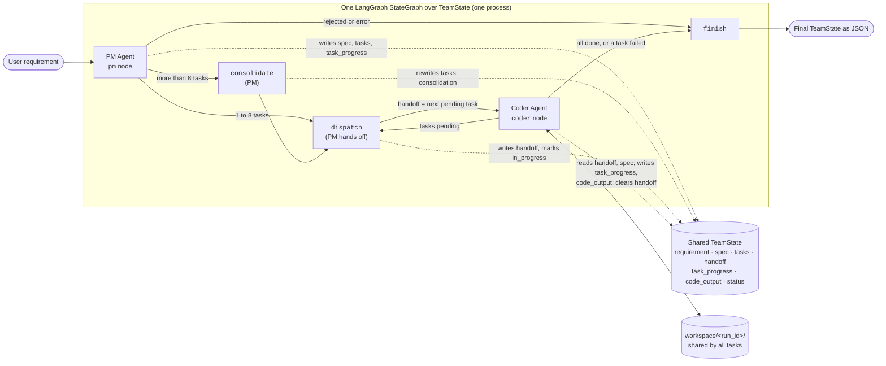

# Implementation Plan: Autonomous Multi-Agent Development Team — Increment 2: PM Agent and PM → Coder Handoff

**Branch**: `dev` (spec directory: `001-autonomous-dev-team`) | **Date**: 2026-10-17 | **Spec**: [spec.md](spec.md)

**Input**: Feature specification from `specs/001-autonomous-dev-team/spec.md`, scoped by the
user to a second increment: add the Product Manager (PM) Agent and hand its tasks to the
Coder Agent from Increment 1, both agents working in one LangGraph orchestration graph over
a shared, typed state.

## Summary

Turn the standalone Coder Agent into a two-agent team. The PM Agent (`agents/pm_agent.py`)
reads a plain-English requirement and, in one structured-output Claude call, writes a
technical specification: name, description, acceptance criteria, assumptions, and an
ordered list of tasks. The system gives each task an ID (`T1`, `T2`, …). If the PM
proposes more than 8 tasks, a consolidation step merges them to 8 or fewer before any
work is handed off.

A new team graph (`orchestration/team.py`) runs both agents in one LangGraph `StateGraph`
over a shared `TeamState` `TypedDict` (`orchestration/state.py`). The PM side publishes
one task at a time on the `handoff` state key: task ID, title, description, acceptance
criteria, and priority. The Coder side reads `handoff`, runs the existing `CoderAgent` on
it in a workspace shared by all of the run's tasks, records the task's status and the
code it wrote in shared state, and clears `handoff`. This repeats in task order until
every task is done or one fails. The final state is JSON, because every value in it is a
string, number, boolean, `None`, list, or typed dict.

Technical approach and alternatives: [research.md](research.md) R12–R19. Types:
[data-model.md](data-model.md#increment-2-shared-team-state). Interfaces:
[contracts/handoff-protocol.md](contracts/handoff-protocol.md),
[contracts/task-handoff.schema.json](contracts/task-handoff.schema.json),
[contracts/pm-agent-api.md](contracts/pm-agent-api.md),
[contracts/team-api.md](contracts/team-api.md).

### Spec coverage in this increment

| Covered now | Deferred to later increments |
|-------------|------------------------------|
| FR-001, FR-002 (one requirement in, no further input), FR-003 *partially* (PM → Coder in one graph; no QA yet), FR-004 (empty input refused, non-software requirement rejected by the PM), FR-005 (spec with description and acceptance criteria), FR-006, FR-006a, FR-006b (ordered tasks with acceptance criteria and a priority; at most 8), FR-007 (assumptions recorded), FR-009, FR-009a (all tasks in order; the run stops at the first failed task), FR-025 *partially* (run status, the failed task, per-task status and time, PM assumptions, token usage, elapsed time; not dollar spend, which needs FR-022) | FR-008a (dependencies and stand-ins: needs QA and the install step), FR-011/FR-011a (packages), Coder ⇄ QA loop and FR-012–FR-020, FR-022 (iteration/time/spend limits), FR-024 (saving the spec, tasks and report as separate files; the final state is printed as JSON instead), FR-026 iteration records |

Increment 1 (Coder Agent, `agents/coder_agent.py`, `tools/`, `agents/memory.py`) is
delivered. Its plan is archived in [plan-increment-1.md](plan-increment-1.md) and its
design is in research R1–R11. It is unchanged here except for one backward-compatible
parameter (R17).

## Technical Context

**Language/Version**: Python 3.12

**Primary Dependencies**: unchanged: `anthropic` 1.11.0, `langgraph` 1.2.12, `chromadb`
1.5.9, `python-dotenv` 1.2.3, `pysqlite3-binary` (Linux). No new packages. Shared-state
types use stdlib `typing.TypedDict` and `Literal`; Pydantic is not imported (R12).

**Storage**: the run's workspace `workspace/<run_id>/`, shared by every task of the run;
Chroma at `.chroma/` (the Coder's memory, unchanged). The final `TeamState` is printed as
JSON; it is not written to disk in this increment.

**Testing**: stdlib `unittest`. Offline tests use a fake Anthropic client for the PM and a
fake Coder (any object with `run(task, workspace)`), so the team-graph tests need neither
Docker nor credentials (R19).

**Target Platform**: Linux host with Docker (unchanged: generated code runs only in
Increment 1's sandbox containers)

**Project Type**: Python library + CLI (`python -m orchestration.team "<requirement>"`;
`python -m agents.coder_agent` keeps working)

**Performance Goals**: The PM step finishes in under 1 minute. A small requirement
(≤ 4 tasks) finishes in under 10 minutes (SC-004).

**Constraints**: ≤ 8 tasks per requirement, enforced in code (R16). One consolidation call
at most. Tasks run strictly in list order, one at a time. Worst case 2 PM calls plus
8 × 11 Coder calls. Every shared-state value has a declared type and converts to JSON as
is. Both agents run in one graph in one process.

**Scale/Scope**: One user, one requirement per run, up to 8 tasks, each within the Coder's
10-step cap

No item is marked NEEDS CLARIFICATION: the user fixed the framework (LangGraph), the cap
(8), the handoff fields, and the schema style (TypedDict or Pydantic). R12–R19 settle
everything else.

## Constitution Check

*GATE: Must pass before Phase 0 research. Re-check after Phase 1 design.*

| Gate | Pre-research | Post-design | Notes |
|------|:---:|:---:|-------|
| I. Clean Code: intent-revealing names, functions ≤ ~40 lines, type hints + docstrings on public API, explicit error handling | ✅ | ✅ | Each graph node is a small public function taking explicit arguments. The PM reports API errors, refusals and malformed output in `PMResult.error` and never raises them. No bare `except` |
| II. Simple Design: no speculative abstractions, plain functions, one responsibility per module | ✅ | ✅ | No `Agent` base class, `Protocol`, registry or message bus. `PMAgent` is a class only because it holds a client and config, like `CoderAgent`. The handoff reuses the `Task` type instead of adding an envelope type (R14). `orchestration/state.py` owns the schema, `orchestration/team.py` owns the graph, `agents/pm_agent.py` owns PM behavior. `agents/llm.py` holds only the request settings both agents already use (two concrete users), so the PM does not import the Coder |
| III. Minimal Dependencies: stdlib first, no new packages, `langgraph` core API only | ✅ | ✅ | No new packages. `TypedDict` instead of Pydantic (R12). Only `StateGraph`, `START`, `END` and their methods (`add_node`, `add_edge`, `add_conditional_edges`, `compile`, `invoke`/`stream`). No subgraph helpers, prebuilt agents, checkpointers or reducers (R13) |
| Python Standards: PEP 8/257, grouped imports, secrets from env, `__main__` guard, stdlib tests | ✅ | ✅ | New `PM_MODEL`/`PM_EFFORT`/`PM_USE_FALLBACKS` settings come from env. The team CLI is under `if __name__ == "__main__":`. Tests use `unittest` |
| Workflow: tests for new behavior, small focused changes | ✅ | ✅ | The PM, the cap and consolidation, every node, the handoff schema and the whole graph each have offline tests. The README change is its own task |

**Result**: PASS (constitution v1.1.1). No violations to track.

## System Diagram

The README gets this diagram and the table below it.



| State key | Written by | Read by |
|-----------|-----------|---------|
| `requirement` | `run_team` (input) | `pm`, `consolidate` |
| `spec`, `tasks` | `pm`, `consolidate` | `dispatch`, `coder`, `finish` |
| `handoff` | `dispatch` (sets), `coder` (clears) | `coder` |
| `task_progress` | `pm` (all pending), `dispatch`, `coder`, `finish` | routers, `dispatch` |
| `code_output` | `coder` (appends after each task) | caller |
| `consolidation` | `consolidate` | caller |
| `status`, `error`, `usage` | every node that changes them | routers, caller |

## Project Structure

### Documentation (this feature)

```text
specs/001-autonomous-dev-team/
├── spec.md
├── plan.md                      # This file (Increment 2)
├── plan-increment-1.md          # Increment 1 plan, archived
├── research.md                  # R1–R11 Increment 1; R12–R19 Increment 2
├── data-model.md                # + "Increment 2: Shared Team State"
├── quickstart.md                # + Increment 2 scenarios 6–10
├── contracts/
│   ├── coder-agent-api.md       # updated: run(task, workspace=None)
│   ├── tools.md                 # unchanged
│   ├── pm-agent-api.md          # new
│   ├── handoff-protocol.md      # new
│   ├── task-handoff.schema.json # new (JSON Schema for one handoff message)
│   └── team-api.md              # new (graph, run_team, CLI)
├── checklists/
│   └── requirements.md
└── tasks.md                     # Increment 1 (complete); /speckit-tasks replaces it for Increment 2
```

### Source Code (repository root)

```text
orchestration/
├── __init__.py          # new, empty package marker
├── state.py             # new: TeamState and its TypedDicts (Task, TechnicalSpec, TaskProgress, …)
└── team.py              # new: node functions, routers, build_team_graph, run_team, CLI

agents/
├── coder_agent.py       # changed: run(task, workspace=None); shared settings moved to llm.py
├── llm.py               # new: EFFORT_LEVELS, MAX_TOKENS, FALLBACK_BETA, refusal_message (used by both agents)
├── memory.py            # unchanged
├── pm_agent.py          # filled in (was an empty placeholder): PMConfig, PMResult, PMAgent, merge_tasks,
│                        #   validate_tasks, criteria_preserved
└── qa_agent.py          # empty placeholder, untouched

tools/                   # unchanged

tests/
├── team_fakes.py             # new: FakePMClient, FakeCoder, payload helpers (not a test module)
├── test_team_state.py        # new: state types match the contract and round-trip through JSON
├── test_pm_agent.py          # new: spec parsing, task IDs, rejection, refusal/API errors, checked consolidation, merge_tasks
├── test_team_handoff.py      # new: pm node writes a non-empty, schema-correct task list; dispatch/coder nodes; full graph
├── test_team_record.py       # new: progress updates, run record, durations, CLI output and exit codes
├── test_coder_agent_loop.py  # + shared-workspace test for run(task, workspace)
└── …                         # existing tests unchanged

README.md                # system diagram, team usage, updated status/layout/design decisions
```

**Structure Decision**: Single Python project. The `orchestration/` folder, empty since
Increment 1 for this purpose, now holds the shared state schema and the team graph. Both
agents depend on the schema, and the schema depends on neither agent. Agent behavior stays
in `agents/`. `agents/pm_agent.py` imports types from `orchestration/state.py`;
`orchestration/team.py` imports both agents. Nothing imports `orchestration/team.py`, so
there are no import cycles.

## Spec Deviations (this increment)

| Spec item | This increment | Why | Resolution |
|-----------|----------------|-----|------------|
| FR-024: save spec, task list and report as files | The final `TeamState` (which contains all of them) is printed to stdout as JSON | Saving files belongs with the outcome-report work (US3) | Deferred |
| Increment 1 deviations | Still apply: the Coder's 10-step cap (`max_steps`) and standard-library-only code | Unchanged | The PM prompt states the stdlib-only, no-network limit so tasks stay buildable (R15) |

The 8-task cap (FR-006a), what priority controls (FR-006b), and stopping the run when a
task fails (FR-009a) were deviations in the first draft of this plan. Clarification on
2026-10-17 added them to the spec, so they are now requirements.

## Complexity Tracking

No violations.
