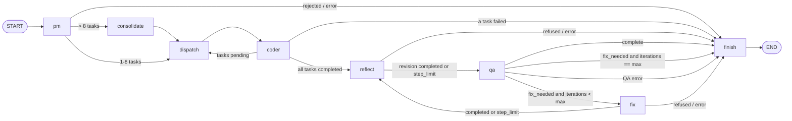

# Contract: Coder ⇄ QA Feedback Loop (team graph)

Changes to `orchestration/team.py` and `orchestration/state.py` (research R13, R14). The
PM, consolidation, dispatch and build parts of
[001 contracts/team-api.md](../../001-autonomous-dev-team/contracts/team-api.md) and
[handoff-protocol.md](../../001-autonomous-dev-team/contracts/handoff-protocol.md) are
unchanged.

## Graph



The build loop (`dispatch ⇄ coder`) works as before. The only change is that
`route_after_coder` sends a fully completed build to `reflect`, not to `finish`.

## Nodes

Every Coder ⇄ QA exchange goes through the A2A broker
([a2a-binding.md](a2a-binding.md), research R21). The `qa`, `fix` and `finish` nodes get
`A2AClient`s, never a QA or Coder object. `reflect` stays a direct Coder call, because
it is the Coder's own work (FR-129).

| Node | Calls | Writes to state |
|------|-------|-----------------|
| `reflect` | `coder.reflect(render_reflection_brief(state), workspace)` | `pending_reflections` (with `before_iteration = len(iterations) + 1`), `usage`. On `refused` or `error`: `status="failed"`, `end_reason="reflection_failed"`, `error` |
| `qa` | `clients["coder"].send_message("qa-debugger", review_message(state))` (skill `review-program`, `contextId=run_id`) → reads the `qa-iteration` artifact | appends an `Iteration` (holding `pending_reflections`, `review_task_id`), clears `pending_reflections`, sets `test_suite`, `usage` and `a2a_log`. Task `FAILED`: `status="error"`, `end_reason="qa_failed"`. `REJECTED`, an A2A error or a timeout: `status="error"`, `end_reason="a2a_failed"`. `error` holds the status message or error detail |
| `fix` | `clients["qa-debugger"].send_message("coder", fix_message(state))` (skill `fix-program`, text = `render_fix_brief(state)`, `referenceTaskIds=[iterations[-1].review_task_id]`) → reads the `coder-fix` artifact | sets `iterations[-1].fix = CoderFix(...)`, `fix_task_id`, `usage` and `a2a_log`. Task `FAILED`: `status="failed"`, `end_reason="coder_failed"`, `error` naming the iteration. `REJECTED`, an A2A error or a timeout: `end_reason="a2a_failed"` |
| `finish` | if `iterations`: `clients["team"].send_message("qa-debugger", report_message(state, status, end_reason))` (skill `final-report`; sent after `finish` has decided the status and end reason, which go into the `FinalReportRequest`) | `status`, `end_reason`, `error`, `qa_report`, `a2a_log`. If the report exchange fails (task `FAILED`/`REJECTED`, `A2AError` or timeout), `qa_report` stays `None` and `"final report missing: <cause>"` is appended to `error` (joined with `"; "` if `error` already holds a message, so an earlier error such as the iteration-limit message is kept). `status` and `end_reason` are not changed (spec FR-118, edge case "The final-report request fails"). Runs that never reached QA are unchanged |

Message builders are pure functions in `orchestration/team.py`: `review_message(state)`,
`fix_message(state)` and `report_message(state, status, end_reason)`. Their `data` parts are a `QAContext`,
a `FixRequest` and a `FinalReportRequest` respectively ([data-model.md](../data-model.md),
"QA request payloads"). After each send, the node sets
`a2a_log = clients[<sender>].exchanges()`. Each uses `messaging.a2a`'s
`text_part`, `data_part` and `user_message`.

## Routing (pure functions, unit-tested)

```python
def route_after_coder(state) -> str:   # "dispatch" | "reflect" | "finish"
def route_after_reflect(state) -> str:  # "qa" | "finish"
def route_after_qa(state) -> str:       # "fix" | "finish"
def route_after_fix(state) -> str:      # "reflect" | "finish"
```

`route_after_qa` returns `"fix"` only when all three hold:
- `status == "running"`
- `iterations[-1].verdict == "fix_needed"`
- `len(iterations) < max_iterations`

Otherwise it returns `"finish"`. This is the convergence safeguard. `finish` then sets:

| Last iteration | `status` | `end_reason` |
|----------------|----------|--------------|
| `complete` | `completed` | `complete` |
| `fix_needed` and `len == max_iterations` | `failed` | `iteration_limit` (`error = "Iteration limit reached (5 of 5) with 2 unresolved blocking findings"`) |
| already failed or errored | unchanged | unchanged |

## Briefs (task text for the Coder)

**`render_reflection_brief(state)`**: the spec name, description and acceptance
criteria, then every task's title and criteria, then "Review the program in the
workspace against this specification before it goes to QA."

**`render_fix_brief(state)`** for iteration *k*:

```text
You are fixing: <spec name>. QA review #<k> of <max> found problems.
Acceptance criteria:
- ...
Test results: <passed> passed, <failed> failed, <errors> errors.

Blocking findings (fix every one, or dispute it with a reason from the specification):
[F2-1] <file> <location>
  Problem: <problem>
  Expected: <expected>
  Likely cause: <likely_cause>
  Fix: <fix_instruction>
  Failing tests: <test_ids>
...
Advisory findings (optional):
[F2-4] ...

Tests are in tests/. You may read them but not change them.
Answer every F… ID above in finding_responses.
```

## Settings and CLI

| Setting | Default | Range | Source |
|---------|---------|-------|--------|
| maximum iterations | 5 | 1–10 | `TEAM_MAX_ITERATIONS`, overridden by `--max-iterations N` |
| reflection rounds | 1 | 1–3 | `CODER_REFLECTION_ROUNDS` |
| QA test time limit | 60 s | > 0 | `QA_TEST_TIMEOUT` |
| QA model and effort | `claude-sonnet-5-5`, `high` | | `QA_MODEL`, `QA_EFFORT` |
| A2A request time limit | 1800 s | > 0 | `A2A_REQUEST_TIMEOUT` |

```python
MAX_ITERATIONS_CAP = 10
DEFAULT_MAX_ITERATIONS = 5

def max_iterations_from_env(env=os.environ) -> int: ...  # ValueError when malformed or outside 1-10

def run_team(requirement, pm=None, coder=None,
             workspace_root=Path("workspace"), on_update=None, *,
             qa=None,
             max_iterations: int = DEFAULT_MAX_ITERATIONS,
             a2a_timeout_seconds: float = 1800.0) -> TeamState
# The first five parameters keep their 001 positions; the new ones are keyword-only.
```

`run_team` raises `ValueError` before any model call if `max_iterations` is outside
1–10. `qa` is any object with `run_iteration(context: QAContext)` and
`final_report(request: FinalReportRequest)`, so
tests can pass a fake.

`run_team` opens `with A2ABroker(a2a_timeout_seconds) as broker:`, calls
`register_team_agents(broker, coder, qa, version)`, and builds the graph with
`clients = {name: broker.client(name) for name in ("coder", "qa-debugger", "team")}`.
`build_team_graph(pm, coder, clients)` no longer takes `qa`. The broker is closed when
the run ends, including on exceptions. The CLI exits with 0 if `status == "completed"`, 1 for any
other run result, and 2 for usage errors, including an out-of-range iteration limit,
`SandboxUnavailableError` and `McpUnavailableError` at start-up. The final JSON gains
`iterations`, `qa_report` and `end_reason`. The last stderr line gives the report path.

`RECURSION_LIMIT = 2 * MAX_TASKS + 3 * MAX_ITERATIONS_CAP + 6`.

## Progress lines (stderr, FR-119)

```text
[reflect] before QA #1: 3 critique items, revision completed (6 steps)
[a2a] coder → qa-debugger review-program task 3f2a… completed (48.2 s)
[qa] #1: 9 passed, 2 failed, 0 errors → 3 blocking, 1 advisory
[a2a] qa-debugger → coder fix-program task 9c1e… completed (71.0 s)
[fix] #1: completed (7 steps), answered 3 of 3 (1 disputed)
[reflect] before QA #2: 2 critique items, revision step_limit (10 steps)
[qa] #2: 11 passed, 0 failed, 0 errors → complete
[finish] completed (complete) · report: workspace/<run_id>/.qa/report.md
```

`format_update` handles each new node name. Existing lines are unchanged.
