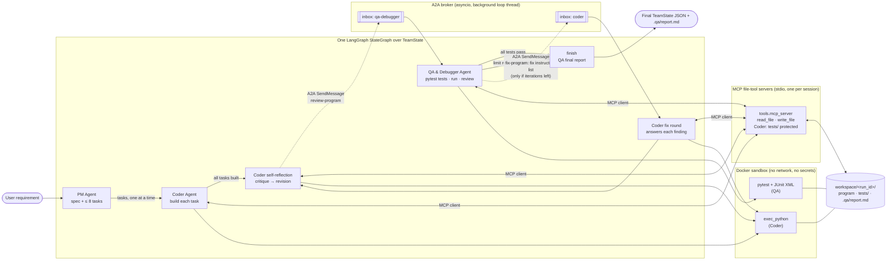

# Implementation Plan: QA & Debugger Agent, Coder ⇄ QA Feedback Loop, and MCP File Tools

**Branch**: `dev` (spec directory: `002-qa-feedback-loop-mcp`) | **Date**: 2026-10-18, updated 2026-10-19 | **Spec**: [spec.md](spec.md)

**Input**: Feature specification from `specs/002-qa-feedback-loop-mcp/spec.md`, plus the
user's planning directives from two passes.

- **Second pass (2026-10-19)**: "Implement Google's A2A protocol to facilitate
  communication between the Coder agent and QA agent. Use Python's asyncio to set up a
  broker that decouples the messages between the agents". See Summary item 6 and research
  R17–R22.
- **First pass (2026-10-18)**: pytest tests that are really run in a sandbox; a
structured fix instruction list; Coder self-reflection before every QA handoff; an MCP
server for the file tools, using the official Python SDK, with the agents as MCP clients;
a QA final report when the limit is reached; tests for QA and for both ways the loop
ends; a README update; and a maximum of 5 iterations set by an environment variable.

## Summary

Complete the PM → Coder ⇄ QA team on top of 001's delivered PM and Coder:

1. **QA & Debugger Agent** (`agents/qa_agent.py`): a fixed pipeline of structured-output
   Claude calls and deterministic steps, not a second ReAct agent.
   - It writes pytest tests from the spec, seeing only the program's public interface.
   - It runs them in a network-less, read-only, resource-limited Docker sandbox.
   - It parses the JUnit XML, then reviews the full code.
   - It returns a normalised findings list: the **fix instruction list**. Code enforces
     the coverage, severity and verdict rules.
2. **Feedback loop** (`orchestration/team.py`): new graph nodes
   `reflect → qa → fix → reflect → qa …`, ending when QA says `complete` or after
   `TEAM_MAX_ITERATIONS` reviews (5 by default, 1–10). On every finished run that
   reached QA, QA writes a deterministic final report of unresolved issues.
3. **Coder self-reflection** (`CoderAgent.reflect`): before every QA handoff, a tool-less
   critique call (at least one item) and then a revision ReAct session that must answer
   each item.
4. **MCP file-tool server** (`tools/mcp_server.py`, `mcp==2.3.0`, low-level `Server`,
   stdio): exposes exactly `read_file` and `write_file` for one workspace.
   - The Coder's and QA's sessions connect to it as MCP clients through a small sync
     bridge (`tools/mcp_client.py`).
   - The Coder's servers refuse writes under `tests/` and `.qa/`.
   - It can also run on its own for any MCP client.
5. **Sandbox image** with pytest built in (`sandbox/Dockerfile`, derived from the
   existing pinned base), shared by the Coder and QA.
6. **A2A communication through an asyncio broker** (`messaging/`), with no new
   dependency:
   - Every Coder ⇄ QA exchange travels as an **A2A 1.0** message: `review-program`
     (Coder → QA), `fix-program` (QA → Coder) and `final-report`.
   - The transport is a documented custom binding
     (`urn:multi-agent-lab:a2a-binding:asyncio-broker:1.0`) with per-recipient
     `asyncio.Queue` inboxes, one worker per agent and request/reply futures, running on
     a background loop thread.
   - Messages are copied as JSON at the broker boundary, so the agents share no objects
     and neither imports the other.
   - Each agent publishes an agent card. Every exchange, with its task states, goes into
     `TeamState.a2a_log`.
   - The team graph still drives the loop, sending each message on behalf of the agent
     whose turn it is.
7. **Tests and README**: offline `unittest` coverage for each part, and README sections
   on the MCP integration (what and why) with an updated three-agent diagram.

## Spec coverage

| Covered | Notes |
|---------|-------|
| US1 (FR-101–FR-107a, FR-111a) | QA pipeline, research R7–R10 |
| US2 (FR-108–FR-116a, FR-126–FR-128) | loop, fix rounds, disputes, reflection: R11–R13 |
| US3 (FR-120–FR-125) | MCP server and client: R1–R5 |
| SC-102, SC-103 | Fixed 10-requirement benchmark plus a runner that scores both criteria (and reports 001 SC-004): [benchmark.md](contracts/benchmark.md), Phase 6 tasks |
| FR-129–FR-133, SC-109, SC-110 | A2A data model, broker binding, agent cards, exchange log, timeouts: R17–R22, [a2a-binding.md](contracts/a2a-binding.md) |
| FR-117–FR-119 | `Iteration` records, `QAReport`, progress lines: R14, [feedback-loop.md](contracts/feedback-loop.md) |
| 001 FR-012–FR-020 | delivered by the rows above |

Still deferred, as the spec's Assumptions say: 001 FR-022's time and spend limits,
packages and the install step (001 FR-011/FR-011a), and saving the spec, tasks and
outcome as separate files (001 FR-024). The final `TeamState` is still printed as JSON,
and only the QA report is written to disk (`.qa/report.md`).

### Spec updates made during planning

The planning input added requirements, so the spec was updated so the two documents
agree:
- **FR-115**: the environment variable, with the CLI option winning.
- **FR-126–FR-128**: Coder self-reflection.
- **FR-117**: the reflection is part of each iteration's record.
- **FR-118**: QA always produces a final report.
- **US2 scenario 7** and the entities Self-Reflection and QA Report.
- **Assumptions**: generated tests use pytest, built into the sandbox image.
- **Edge case**: the regression-test wording now says it runs in every later iteration.
- **Second pass (A2A)**: FR-129–FR-133, SC-109–SC-110, US2 scenario 8, the entities Agent
  Card, A2A Message / Task and Message Broker, and the Assumption "A2A scope".

There are no remaining spec deviations.

## Technical Context

**Language/Version**: Python 3.12 (host and sandbox)

**Primary Dependencies**:
- Existing: `anthropic` 1.11.0, `langgraph` 1.2.12, `chromadb` 1.5.9, `python-dotenv`
  1.2.3, `pysqlite3-binary` (Linux).
- **New: `mcp==2.3.0`** (official MCP Python SDK; justified in R16).
- **A2A adds no dependency**: the A2A 1.0 types, the JSON-RPC envelopes and the broker
  use stdlib `asyncio`, `json`, `uuid`, `datetime` and `typing`. `a2a-sdk` was rejected
  in R17: its value is in HTTP and gRPC transports this feature doesn't use, and it would
  add google-api-core and json-rpc to model a few JSON shapes.
- **Sandbox-image-only: `pytest==9.1.1`**. It is not a project dependency, and project
  code never imports it (R6).
- New shared-state types use `TypedDict` and `Literal` as in 001.

**Storage**:
- `workspace/<run_id>/` holds the program, `tests/` (owned by QA) and `.qa/report.md`.
- JUnit output goes to a per-run host temporary folder outside the workspace.
- Chroma `.chroma/` is unchanged.

**Testing**: stdlib `unittest` (`python -m unittest discover -s tests -t .`).
- New offline modules use a fake Anthropic client, a fake test runner, fake Coder and
  QA objects, and the real MCP server over stdio.
- One end-to-end pytest-in-sandbox case is skipped without Docker (R15).

**Target Platform**: Linux host with Docker. Generated code and generated tests run only
in sandbox containers.

**Project Type**: Python library + CLIs:
- `python -m orchestration.team`, now with `--max-iterations`
- `python -m agents.coder_agent`
- `python -m tools.mcp_server --workspace DIR`

**Performance Goals**:
- One QA iteration takes 2–4 model calls and 1–3 sandbox test runs, and finishes in
  under 3 minutes for a small requirement.
- MCP session start-up is under 2 s.
- A small requirement still finishes in under 10 minutes when it converges within 2
  iterations (001 SC-004).

**Constraints**:
- At most 10 QA reviews (5 by default) per run, checked in one routing function.
- Each pytest run is limited to 60 s, with no network, a read-only `tests/` mount, a
  512 MB / 1 CPU / 128-process cap, and no environment variables.
- The tool list is fixed for each Coder session, as preserved thinking requires.
- No secrets reach MCP server processes or sandboxes.
- QA reads only the interface before writing tests.

**A2A constraints**:
- One broker per run, in-process only, with no network and no authentication (spec
  Assumption "A2A scope").
- Each agent handles its messages one at a time, in order.
- The request time limit is `A2A_REQUEST_TIMEOUT`, 1800 s by default.
- Streaming, push notifications and the extended card are not supported, and the cards
  say so.

**Scale/Scope**: One user, one run at a time, up to 8 tasks, and per run up to 10
iterations, 3 reflection rounds per handoff and about 30 MCP sessions.

No item is marked NEEDS CLARIFICATION: the spec's clarifications and the planning input
fixed the choices that matter, and research R1–R16 settles the rest.

## Constitution Check

*GATE: Must pass before Phase 0 research. Re-check after Phase 1 design.*

| Gate | Pre-research | Post-design | Notes |
|------|:---:|:---:|-------|
| I. Clean Code: intent-revealing names, functions ≤ ~40 lines, type hints + docstrings, explicit errors | ✅ | ✅ | Each QA step is its own small function (`write_tests`, `resolve_disputes`, `repair_tests`, `review`, `normalise_findings`, `verdict_for`). Model, MCP and sandbox failures come back as `error` fields with the cause, or as `McpUnavailableError` / `SandboxUnavailableError`, which are never swallowed. MCP handlers return error results explicitly, with no bare `except` |
| II. Simple Design: no speculative abstractions, one responsibility per module | ✅ | ✅ | No agent base class, protocol layer or plugin registry. QA is a fixed pipeline, not a second ReAct loop (R8). The sync bridge is the one class the async SDK forces (R3). Module roles: `tools/mcp_server.py` serves, `tools/mcp_client.py` connects, `tools/test_runner.py` runs pytest, `agents/qa_agent.py` owns QA behavior, `orchestration/team.py` owns the loop. Reflection reuses `CoderAgent.run()` and has no second loop |
| III. Minimal Dependencies | ✅ | ✅ | One new runtime package, `mcp`, justified in R16 (problem, why not stdlib, maintenance and license, transitive packages, no HTTP-stack overlap). Only its low-level `Server`, `stdio_server`, `ClientSession`, `stdio_client` and `mcp.types` are used. pytest exists only inside the sandbox image. `langgraph` stays on `StateGraph`/`START`/`END`. JUnit parsing uses stdlib `xml.etree`, and interface extraction uses stdlib `ast` |
| Python Standards: 3.12 everywhere, PEP 8/257, env-based config, `__main__` guards, stdlib tests | ✅ | ✅ | The sandbox image is derived from the same pinned `python:3.12-slim` digest. New settings (`TEAM_MAX_ITERATIONS`, `QA_*`, `CODER_REFLECTION_ROUNDS`) come from the environment. `tools/mcp_server.py` has a `__main__` guard. Project tests stay `unittest` |
| III (A2A pass): stdlib first | ✅ | ✅ | The A2A types, broker and endpoints use only the standard library. `a2a-sdk` was rejected because its value is in unused HTTP and gRPC transports, and it would still add google-api-core and json-rpc (R17) |
| II (A2A pass): simple design | ✅ | ✅ | Three small modules with one job each. `messaging/a2a.py` is protocol data, `broker.py` is transport, `endpoints.py` adapts the agents. No plugin system or transport abstraction: only the one binding the user asked for. The broker uses the same sync-bridge pattern as `McpFileTools`. The graph keeps loop control, so the end guarantee stays in one router |
| Workflow: tests for new behavior, small focused changes | ✅ | ✅ | Each component has its own test module (R15). README, constitution amendment and code are separate tasks and commits |

**Result**: PASS (constitution v1.1.1). There are no violations. One follow-up is
recommended but not needed for the gate: a MINOR constitution amendment (v1.2.0) adding
`mcp` to the approved baseline and noting that pytest is allowed only inside the sandbox
image (R16).

## System Diagram

The README gets this diagram, replacing the PM → Coder one.



| Who | Reads | Writes |
|-----|-------|--------|
| Coder (build, revision, fix) | anything in the workspace through MCP | source files through MCP. `tests/` and `.qa/` are refused |
| QA | the interface (iteration 1, before tests), then the full source and tests through MCP | `tests/**`, `.qa/report.md` through MCP |
| Sandbox runs | the workspace (`tests/` read-only) | the workspace (Coder `exec_python`), `/qa-out` (pytest) |

## README update (planning input)

`README.md` changes:
- The status section becomes "Increment 3: the full three-agent team".
- A new section, "Agent-to-agent communication (A2A)", covers:
  - why A2A: a standard message, task and agent-card model, so either agent could later
    move out of process without changing the messages;
  - the asyncio broker (per-agent inboxes, ordered delivery, matching replies to
    requests, copies at the boundary);
  - the custom binding URN, and what it does not support (streaming, push, auth);
  - the two agent cards and their skills;
  - how to read `a2a_log`;
  - the `A2A_REQUEST_TIMEOUT` setting.
- The diagram above replaces the old one.
- A new section, "MCP integration: what and why", covers:
  - what is exposed (`read_file` and `write_file` only) and what is not (`exec_python`,
    because it needs the run's sandbox settings);
  - why MCP: a standard, discoverable tool interface; the same tools reusable by any MCP
    client; the Coder's restrictions enforced in a separate process the model cannot
    argue with; one place where workspace confinement lives;
  - why the low-level server and stdio (R1, R2);
  - how to connect an outside client (the snippet from
    [contracts/mcp-file-server.md](contracts/mcp-file-server.md)).
- New subsections on the QA agent (the pipeline, the sandboxed pytest run, the fix
  instruction list), the loop and its safeguards (`TEAM_MAX_ITERATIONS`, the final
  report), and Coder self-reflection.
- The configuration table gains `TEAM_MAX_ITERATIONS`, `CODER_REFLECTION_ROUNDS`, `QA_MODEL`,
  `QA_EFFORT`, `QA_TEST_TIMEOUT`, `QA_REPAIR_ATTEMPTS` and `QA_USE_FALLBACKS`.
- The test instructions gain the new modules.

## Project Structure

### Documentation (this feature)

```text
specs/002-qa-feedback-loop-mcp/
├── spec.md                      # Feature spec (clarified, updated during planning)
├── plan.md                      # This file
├── research.md                  # R1–R16
├── data-model.md                # New TeamState keys and QA/loop/reflection types
├── quickstart.md                # Validation scenarios 1–8
├── contracts/
│   ├── qa-agent-api.md          # QAAgent, QAConfig, pipeline, schemas, test runner
│   ├── qa-findings.schema.json  # The fix instruction list (normalised findings)
│   ├── mcp-file-server.md       # Server CLI, tools, errors, McpFileTools client
│   ├── coder-reflection.md      # reflect(), CRITIQUE_FORMAT, finding_responses
│   ├── feedback-loop.md         # Graph, routing, briefs, settings, progress lines (qa/fix/finish via A2A)
│   ├── a2a-binding.md           # A2A 1.0 custom binding: envelope, mappings, ops, errors, cards, skills
│   └── benchmark.md             # Benchmark set v1 (10 requirements), runner CLI, records, scoring, results file
├── checklists/requirements.md
└── tasks.md                     # /speckit-tasks output (not created here)
```

### Source Code (repository root)

```text
agents/
├── coder_agent.py      # + reflect(), CRITIQUE_FORMAT, finding_responses, MCP tools per run()
├── qa_agent.py         # NEW (was an empty placeholder): QAConfig, QAAgent, prompts, schemas,
│                       #   interface_summary, normalise_findings, final_report
├── llm.py              # unchanged (shared EFFORT_LEVELS, MAX_TOKENS, FALLBACK_BETA)
├── memory.py           # unchanged
└── pm_agent.py         # unchanged
orchestration/
├── state.py            # + new TypedDicts/Literals and TeamState keys (data-model.md)
└── team.py             # + reflect/qa/fix nodes, routers, briefs, --max-iterations, report
messaging/
├── __init__.py         # NEW: docstring + __version__ = "0.3.0" (the single version constant: agent cards, MCP server)
├── a2a.py              # NEW: A2A 1.0 TypedDicts, builders (text_part, data_part, user_message,
│                       #   agent_message, new_task), validators, error codes, A2AError types
├── broker.py           # NEW: A2ABroker (asyncio inboxes, workers, futures, task store, log), A2AClient
└── endpoints.py        # NEW: qa_card, coder_card, qa_handler, coder_handler, register_team_agents
tools/
├── __init__.py         # dispatch_tool sends file tools to McpFileTools; tool list built per session
├── file_tools.py       # unchanged behavior (+ protected-prefix check helper)
├── mcp_server.py       # NEW: low-level MCP Server over stdio, CLI
├── mcp_client.py       # NEW: McpFileTools sync bridge, McpUnavailableError
├── python_exec.py      # derived sandbox image + build; read-only tests/ mount for Coder runs
└── test_runner.py      # NEW: run_pytest, pytest_command, parse_junit
sandbox/
└── Dockerfile          # NEW: FROM pinned python:3.12-slim + pytest
benchmarks/
├── __init__.py         # NEW
├── requirements.json   # NEW: the fixed 10-requirement benchmark (version 1)
├── run_benchmark.py    # NEW: runs the team on each item, scores SC-102/SC-103, writes results
└── results/            # NEW: committed results files (<UTC timestamp>.json)
tests/
├── team_fakes.py       # + FakeQA, FakeCoder.reflect, fake QA client replies
├── test_qa_agent.py         # NEW
├── test_test_runner.py      # NEW
├── test_mcp_server.py       # NEW
├── test_coder_reflection.py # NEW
├── test_team_loop.py        # NEW (+ loop over a real A2ABroker, SC-109)
├── test_a2a.py              # NEW: A2A 1.0 shapes, builders, validators, cards
├── test_broker.py           # NEW: routing, FIFO, isolation, task ops, errors, timeout, log
├── test_agent_isolation.py  # NEW: Coder and QA modules never import each other (SC-110)
└── (existing modules updated where the tool list / sandbox image / route_after_coder changed)
requirements.txt        # + mcp==2.3.0
tests/test_benchmark.py # NEW: benchmark file, scoring and runner, offline with a fake run_team
README.md               # updated as described above
```

**Structure Decision**: Keep the existing single-project layout (`agents/`,
`orchestration/`, `tools/`, `tests/`). There are three new top-level folders, each with
one job:
- `sandbox/`: only the image recipe, because it is a build input, not Python code.
- `messaging/`: the A2A protocol, the broker and the agent endpoints. They are kept
  apart from `agents/` so the endpoints import no agent module (SC-110).
- `benchmarks/`: the fixed benchmark data, its runner and its committed results. These
  measure the whole team rather than being part of it. Existing
tests that change: `test_tools.py`, where `SANDBOX_IMAGE` is now a local tag and the
digest assertion moves to `SANDBOX_BASE_IMAGE`; `test_team_handoff.py` and
`test_team_record.py`, where a completed build now routes to `reflect`; and
`test_coder_agent_loop.py`, for the tools-per-session and summary schema changes.

## Complexity Tracking

No constitution violations. Two additions are recorded here so reviewers can see them:

| Addition | Why needed | Simpler alternative rejected because |
|----------|------------|--------------------------------------|
| `mcp` runtime dependency (+ transitive `pydantic` v2, `anyio`, `starlette`, `uvicorn`, …) | The user asked for the official Python MCP SDK. MCP is a full JSON-RPC protocol | A hand-written JSON-RPC loop would not be the official SDK, would be more code, and would not be guaranteed to interoperate (R16) |
| `A2ABroker` loop thread + per-agent worker queues | The user asked for an asyncio broker that decouples the agents' messages. The team graph is synchronous | A plain function-call "broker" would not be asyncio and would not decouple the agents. An external broker (Redis or NATS) adds a service and a dependency for one process (R19) |
| Background-thread event loop in `McpFileTools` | The SDK is async, and both agents and LangGraph graphs are sync | Making the agents async rewrites two working agents. Starting a server per tool call costs about 1 s per call (R3) |
